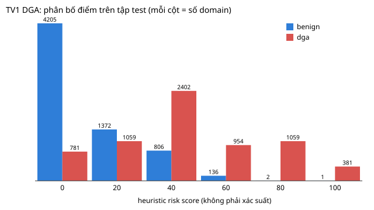

# Sony (TV1): Phát hiện tên miền nghi DGA bằng quy tắc, không dùng AI/ML

**Phạm vi:** phần DGA của đồ án và bảng metrics chung. Thực nghiệm chạy ngày 15/11/2026 trên Python 3.14.5, tldextract 5.4.0, nhánh `feature/dga-no-ml` tạo từ `origin/feature/dns-tunnel` (9942c71). Mọi số liệu dưới đây lấy từ file do chương trình sinh ra trong `handoff/evidence/dga/`; không có số ước lượng.

## 1. DGA là gì và vì sao phát hiện được qua tên miền

Domain Generation Algorithm (DGA) là thuật toán trong mã độc dùng để sinh hàng loạt tên miền từ một seed chung (ngày tháng, hằng số, danh sách từ). Mã độc thử lần lượt các tên này để tìm máy chủ điều khiển (C2). Kẻ tấn công chỉ cần đăng ký một vài tên trong danh sách, nên việc chặn từng domain hay thu giữ một máy chủ không cắt được kênh liên lạc ([MITRE ATT&CK T1568.002](https://attack.mitre.org/techniques/T1568/002/)). Tên do máy sinh thường không được chọn để người đọc hay nhớ: chúng hay dài, trộn chữ và số, ít nguyên âm và có cặp ký tự hiếm gặp trong ngôn ngữ tự nhiên. Các đặc trưng chuỗi bên dưới đo đúng những khác biệt đó.

**Giới hạn cần nói rõ:**

- DGA dùng **danh sách từ** (suppobox, matsnu, pizd, nymaim…) ghép các từ tiếng Anh thật, nên trông như tên tự nhiên. Đặc trưng chuỗi gần như không tách được nhóm này (mục 6).
- Domain hợp lệ cũng có entropy cao: CDN, mã viết tắt, tên có số (`123rf`), tên tiếng nước ngoài, thương hiệu ghép.
- Điểm số là **heuristic risk score 0–100**, không phải xác suất. `suspicious_dga` là đầu mối để điều tra, chưa phải kết luận mã độc.

**Khác với DNS tunneling của Tuấn Anh:** tunneling là hành vi theo thời gian của một client (nhiều subdomain thay đổi trong cửa sổ 60 giây). DGA là đặc trưng của chính tên được đăng ký. Hai module dùng cùng list event nhưng đơn vị phân tích khác nhau.

## 2. Đơn vị phân tích và hợp đồng dữ liệu

**Đơn vị phân tích là nhãn đứng ngay trước public suffix trong registered domain.** Với `a1b2.example.test`, registered domain là `example.test`, subdomain `a1b2` thuộc phạm vi TV2, còn nhãn được chấm là `example`. Tương tự, `www.example.co.uk` cho nhãn `example`. Chương trình **không** tính entropy trên cả tên miền kèm TLD: TLD không do DGA sinh ra, và đưa TLD vào sẽ biến TLD thành đường tắt thống kê.

Đầu vào lấy từ hợp đồng DNS event của Tuấn Anh: `qname`, `registered_domain`, `is_query`, `timestamp`, cộng thêm `src_ip`, `frame_number` để ghi quan sát. Hàm `analyze_dns_domains(dns_events)`:

1. chỉ lấy event có `is_query is True`, bỏ qua response;
2. gộp theo `registered_domain` (nhiều query hoặc nhiều subdomain của một domain cho **một** kết quả) và đính kèm `observations` (`query_count`, `unique_qnames`, `sample_qnames`, `src_ips`, `first_timestamp`, `first_frame`);
3. trả `unknown` có lý do cho query không có registered domain (suffix lạ, tên nội bộ, reverse DNS); các bản ghi này được gộp theo QNAME;
4. sắp xếp: `suspicious_dga` trước, sau đó theo điểm giảm dần, rồi theo tên.

**Quy ước đếm cảnh báo cho Nhi:** chỉ đếm bản ghi có `classification == "suspicious_dga"`. Hai nhãn `benign` và `unknown` không phải cảnh báo.

Giao diện public (`app/dga/`):

```python
normalize_domain(qname: str) -> dict                           # normalizer.py
extract_dga_features(qname: str) -> dict                       # features.py
score_domain(qname: str, config=None) -> dict                  # detector.py
analyze_dns_domains(dns_events: list[dict], config=None) -> list[dict]   # detector.py
```

Tham số `config` không bắt buộc. Mặc định là cấu hình đã đóng băng trên dev (`configs/dga_frozen.json`); có test bảo đảm hai giá trị này trùng nhau.

## 3. Chuẩn hóa tên miền

`normalize_domain` dùng lại `app.dns.normalization.normalize_qname` của Tuấn Anh, để hai module không tách domain theo hai cách mâu thuẫn. Hàm này trim khoảng trắng, bỏ một dấu chấm cuối, đổi chữ thường, mã hóa IDNA và tách registered domain bằng **PSL đi kèm tldextract 5.4.0, không tải mạng và không bật private PSL**. Kết quả tách phụ thuộc vào snapshot PSL của phiên bản đã pin.

| Trường hợp | Kết quả |
|---|---|
| Chuỗi rỗng, `.`, kiểu không phải chuỗi | `unknown`: `empty_domain`, `not_a_string` |
| Ký tự không hợp lệ, nhãn rỗng (`bad..com`) | `unknown`: `invalid_or_unsupported_domain` |
| Địa chỉ IPv4/IPv6 | `unknown`: `ip_address` |
| `localhost` (một nhãn) | `unknown`: `single_label_hostname` |
| `printer.local`, suffix lạ | `unknown`: `unknown_suffix_or_internal_name` |
| `*.in-addr.arpa`, `*.ip6.arpa` | `unknown`: `reverse_dns_name` |
| IDN (`bücher.de` = `xn--bcher-kva.de`) | Tính feature trên dạng **ASCII/Punycode**, nhưng phân loại `unknown` với lý do `idn_label_outside_reference_corpus` |

**Chính sách IDN:** bảng n-gram chỉ có ký tự a-z0-9, nên chuỗi Punycode (`xn--bcher-kva`) luôn trông "hiếm". Chương trình không gắn nhãn DGA cho IDN mà ghi rõ lý do, và vẫn giữ feature để người phân tích xem. Hệ quả: DGA dùng IDN sẽ không bị phát hiện (mục 7).

## 4. Đặc trưng: công thức, ý nghĩa, khi nào gây báo nhầm

Mọi feature tính trên nhãn ASCII. Dấu `-`/`_` được bỏ khi tính tỷ lệ và entropy. Feature là deterministic: không dùng seed, không gọi mạng (có test chặn socket).

| Feature | Công thức | Ý nghĩa | Gây báo nhầm khi |
|---|---|---|---|
| `length` | số ký tự của nhãn | DGA thường dài 10–40 ký tự | Tên ghép nhiều từ (`minecraftforge`), slogan |
| `entropy` | `H = −Σ p_i·log2(p_i)` trên tần suất ký tự; chuỗi dài 0 hoặc 1 → 0 | Ký tự phân bố đều thì H cao. H tối đa là `log2(n)`, nên nhãn ngắn không thể có H cao | Nhãn dài bất kỳ có nhiều ký tự khác nhau |
| `digit_ratio` | số chữ số / số ký tự chữ-số | Nhiều DGA trộn số | `123rf`, `365datascience`, tên miền số của Trung Quốc |
| `vowel_ratio` | số nguyên âm (a,e,i,o,u) / số **chữ cái**; không có chữ cái → null | Từ tự nhiên có khoảng 35–45% nguyên âm | Viết tắt (`cnbc`), tiếng nước ngoài, chữ Hán phiên âm |
| `unique_character_ratio` | số ký tự khác nhau / độ dài | Thông tin phụ; tương quan mạnh với entropy nên **không** làm quy tắc riêng | Như entropy |
| `ngram_score` | trung bình độ hiếm trigram r(g) (bigram nếu đoạn chỉ dài 2) | Cặp/bộ ba ký tự lạ so với tiếng Anh | Tên không phải tiếng Anh, chữ số, viết tắt |

**Độ hiếm n-gram (không dùng ML).** Nhãn được tách thành các đoạn theo `-`/`_`. Trong mỗi đoạn lấy n ký tự liên tiếp, ví dụ bigram của `mail` là `ma`, `ai`, `il`. Mỗi n-gram tra trong bảng tần suất cố định:

```
r(g) = 1 − ln(1 + count(g)) / ln(1 + max_count_n)        ∈ [0, 1]
```

`count(g) = 0` (chưa gặp) cho r = 1. Số +1 là **làm trơn add-one cố định**, tránh log(0). N-gram phổ biến nhất có r = 0. `ngram_score` là trung bình r của các trigram. Phần đầu ra còn có `bigram_rarity`, `trigram_rarity` và `unseen_ngram_ratio`.

**Bảng tham chiếu:** bigram và trigram của danh sách từ tiếng Anh thuộc Leipzig Corpora Collection, do bộ UMUDGA phát hành (giấy phép MIT). Bảng có 735 bigram và 6.373 trigram với count > 0 trên bảng chữ cái a-z0-9, được nhúng cố định trong `app/dga/ngram_reference.py` cùng SHA256 nguồn. File này được sinh bằng `python -m scripts.dga_build_ngram_reference`. Đây là bảng thống kê tham chiếu, **không phải mô hình được huấn luyện**. Bảng không lấy từ danh sách domain đem đi đánh giá, nên không có rò rỉ nhãn.

## 5. Bộ quy tắc và cách chọn ngưỡng

| Quy tắc | Điều kiện | Nhóm tín hiệu | Điểm (bộ `equal`, đang dùng) | Điểm (bộ `ngram_weighted`) |
|---|---|---|---:|---:|
| `unusual_ngrams` | `ngram_score > 0.779542` | ngram | 20 | 35 |
| `high_entropy` | `entropy > 3.189898` | randomness | 20 | 20 |
| `high_digit_ratio` | `digit_ratio > 0.0` | composition | 20 | 15 |
| `low_vowel_ratio` | `vowel_ratio < 0.230769` | composition | 20 | 15 |
| `long_label` | `length > 13` | length | 20 | 15 |

**Điều kiện gắn `suspicious_dga`:**

1. nhãn dài ít nhất 5 ký tự;
2. các quy tắc kích hoạt thuộc ít nhất **2 nhóm tín hiệu khác nhau**;
3. tổng điểm ≥ 40.

Detector dùng 5 quy tắc trên 4 nhóm. `high_digit_ratio` và `low_vowel_ratio` cùng đo thành phần ký tự nên gộp một nhóm: hai quy tắc này cùng kích hoạt vẫn chỉ tính là một tín hiệu, và không đủ để cảnh báo (có test). Một quy tắc đơn lẻ không bao giờ đủ để gắn nhãn.

Nhãn ngắn hơn 5 ký tự được ghi `label_too_short_for_scoring` và không bị gắn cờ, vì entropy tối đa của nhãn 4 ký tự chỉ là 2 bit. `benign` nghĩa là "chưa đủ điều kiện quy tắc", không phải kết luận domain an toàn.

**Chọn ngưỡng trên dev, chỉ một lần.** Ngưỡng không chép từ ví dụ trong tài liệu. Mỗi ngưỡng là **percentile p của chính feature đó trên các domain lành tính của tập dev** (nearest-rank, chỉ tính nhãn ≥ 5 ký tự). Với feature hướng "thấp" (`vowel_ratio`) thì dùng percentile 100−p. So sánh strict, nên mỗi quy tắc kích hoạt trên tối đa (100−p)% domain lành tính của dev. Lưới được khai báo trước khi chạy: p ∈ {90, 95, 99} × bộ trọng số {equal, ngram_weighted} × ngưỡng điểm {40, 50, 60, 70, 80}, tổng cộng 30 ứng viên. Tiêu chí là F1 cao nhất trên dev; nếu hòa thì chọn ít FP hơn, sau đó theo thứ tự lưới. Toàn bộ ứng viên nằm trong `configs/dga_frozen.selection.json`. Tập test không được đọc khi chọn (`scripts/dga_tune.py` chỉ nạp split `dev`).

Cấu hình được chọn: p = 90, bộ `equal`, ngưỡng 40. Nó nằm ở biên của lưới (p nhỏ nhất, ngưỡng thấp nhất). Mở rộng lưới chỉ được làm trên dev và phải đánh giá lại trên một tập test độc lập. Với p = 99, ngưỡng `ngram_score` là 1,0 và ngưỡng `vowel_ratio` là 0,0, nên hai quy tắc đó không bao giờ kích hoạt (so sánh strict). Điều này giải thích vì sao các ứng viên p = 99 kém hẳn.

**So sánh hai bộ trọng số trên dev (P1),** mỗi bộ lấy ứng viên tốt nhất của nó:

| Bộ trọng số | p | Ngưỡng điểm | TP | FP | TN | FN | Precision | Recall | F1 | FPR |
|---|---:|---:|---:|---:|---:|---:|---:|---:|---:|---:|
| equal (chọn) | 90 | 40 | 1.946 | 280 | 2.465 | 818 | 0,8742 | 0,7041 | 0,7800 | 0,1020 |
| ngram_weighted | 90 | 40 | 1.557 | 148 | 2.597 | 1.207 | 0,9132 | 0,5633 | 0,6968 | 0,0539 |

`ngram_weighted` báo nhầm ít hơn khoảng một nửa nhưng bỏ sót thêm 389 domain DGA trên dev. Nếu nhóm ưu tiên ít báo nhầm hơn thì có thể chọn bộ này, nhưng việc đổi phải quyết định trước khi xem test.

## 6. Dữ liệu và kết quả đo

**Dữ liệu** (chi tiết trong `samples/dga/README.md`): UMUDGA v1 (MIT, DOI 10.17632/y8ph45msv8.1). DGA gồm 47 họ, tối đa 200 domain mỗi họ. Lành tính là danh sách `legit` 10.000 tên miền hạng cao. Dữ liệu được loại trùng theo domain và theo nhãn **trước khi** chia split theo hash của nhãn, nên dev và test không chung domain hay nhãn nào (có test kiểm tra).

Bốn họ đặt chuỗi DGA dưới domain DNS động (corebot, kraken_v1, symmi và một nửa kraken_v2) bị loại có lý do, vì đơn vị registered-label không thể chấm chúng.

**Mỗi dòng đánh giá là một domain.** Positive = `suspicious_dga`. `benign` và `unknown` đều tính là không cảnh báo.

| Tập | N domain | Lành tính | DGA | TP | FP | TN | FN | Precision | Recall | F1 | FPR |
|---|---:|---:|---:|---:|---:|---:|---:|---:|---:|---:|---:|
| Dev (dùng để chọn ngưỡng) | 5.509 | 2.745 | 2.764 | 1.946 | 280 | 2.465 | 818 | 0,8742 | 0,7041 | 0,7800 | 0,1020 |
| **Test (độc lập)** | **13.158** | **6.522** | **6.636** | **4.796** | **654** | **5.868** | **1.840** | **0,8800** | **0,7227** | **0,7936** | **0,1003** |

Công thức: Precision = TP/(TP+FP); Recall = TP/(TP+FN); F1 = 2TP/(2TP+FP+FN); FPR = FP/(FP+TN). Trên test có 3 domain lành tính dạng IDN nhận `unknown` (tính là TN). Có 872 domain lành tính có nhãn ngắn hơn 5 ký tự (tính là TN); không domain DGA nào trong test ngắn như vậy.

Nguồn số liệu: `handoff/evidence/dga/dga_metrics.json` và `dga_evaluation.csv` (13.158 dòng, mỗi dòng có feature, điểm, lý do và outcome TP/FP/TN/FN).



**Recall theo họ trên test (rút gọn):**

- **≥ 0,98:** banjori, bedep, ccleaner, chinad, dyre, fobber_v1, murofet_v1/v2/v3, qadars, ranbyus_v1/v2, shiotob, zeus-newgoz.
- **Thấp:** vawtrak_v3 0,014; suppobox_2 0,029; vawtrak_v2 0,035; pushdo 0,176; pizd 0,177; simda 0,200; suppobox_1 0,225; nymaim 0,374; matsnu 0,416.

Danh sách đầy đủ nằm trong `test_per_family` của file metrics.

### Phân tích sai số (lấy từ test)

**False positive (654 domain lành tính bị gắn cờ):**

1. `2agshdqwvcqs.website` (80 điểm: ngram, entropy, số, ít nguyên âm). Chuỗi này trông ngẫu nhiên thật dù có trong danh sách hạng cao. Chỉ từ chuỗi thì quy tắc không phân biệt được; cần bối cảnh như tuổi domain hay danh tiếng.
2. `lostfilm-hd720.ru` (80: entropy, số, ít nguyên âm, dài). Tên thương hiệu ghép với `hd720`; chữ số làm tăng cả `digit_ratio` lẫn độ dài.
3. `123rf.com`, `17zwd.com`, `037hd.com` (60: ngram, số, ít nguyên âm). Nhãn ngắn trộn số. Bảng n-gram tiếng Anh gần như không có trigram chứa chữ số, nên **chữ số kích hoạt đồng thời `unusual_ngrams` và nhóm composition**, tức là bị tính hai lần. Đây là điểm yếu thiết kế lớn nhất, đã được ghi nhận nhưng **không** sửa sau khi xem test.
4. Dạng phổ biến nhất là `high_entropy + long_label` (284/654), chẳng hạn tên ghép nhiều từ như `minecraftforge.net` (có trong fixture PCAP). Tiếp theo là `unusual_ngrams + low_vowel_ratio` (137), thường là viết tắt hoặc tiếng nước ngoài, và `unusual_ngrams + high_digit_ratio` (126).

**False negative (1.840 domain DGA không bị gắn cờ, tất cả có điểm 0 hoặc 20):**

1. `aftercity.net`, `aftercompe.net` (suppobox_2, điểm 0); `actionstreet.net` (pizd); `airline-fear.com` (matsnu). DGA ghép từ điển tiếng Anh nên có n-gram phổ biến, nguyên âm bình thường và không có số. Detector của nhóm thất bại có hệ thống với nhóm này.
2. `adlatangah.com` (vawtrak_v3, 0), `beicuppedir.com` (pushdo, 0), `boniwyk.info` (simda, 0). Các họ sinh chuỗi **phát âm được** (xen kẽ phụ âm–nguyên âm), nên vượt qua cả `vowel_ratio` lẫn n-gram.
3. `abkxakhbtu.com` (alureon, 20: chỉ `unusual_ngrams`) và `agqmecwc.com` (dircrypt). Chuỗi ngẫu nhiên nhưng ngắn (8–10 ký tự), nên entropy và độ dài không vượt ngưỡng. Chỉ một nhóm kích hoạt nên không đủ điều kiện, đúng theo thiết kế "không cảnh báo từ một tín hiệu".

## 7. Hạn chế

- Kết quả phụ thuộc bảng n-gram tham chiếu (tiếng Anh, chỉ chữ và số) và ngưỡng chọn trên dev. Tên tiếng Việt, tiếng Trung phiên âm hoặc tên dùng nhiều chữ số dễ bị báo nhầm.
- Tập lành tính là danh sách tên miền phổ biến, không phải lưu lượng DNS thật của một tổ chức. Tỷ lệ DGA:lành tính xấp xỉ 1:1 trong tập test cao hơn rất nhiều so với thực tế, nên precision trên mạng thật sẽ thấp hơn đáng kể dù FPR giữ nguyên.
- Dev và test lấy cùng nguồn và cùng các họ DGA (chia theo nhãn, không theo họ). Kết quả **không** chứng minh khả năng phát hiện họ DGA mới.
- DGA nằm dưới DNS động/private suffix (`*.ddns.net`) và DGA dùng IDN không được phát hiện theo đơn vị registered-label.
- Chữ số bị tính hai lần (n-gram và composition), xem FP ở mục 6.
- Không phân loại họ DGA (P2), không dùng tuổi domain, WHOIS, NXDOMAIN hay danh tiếng. Đây là heuristic, không phải mô hình ML.

## 8. Tích hợp và minh chứng

- Bước 4.1 của HandOff chạy với `handoff/evidence/query_response_events.json` cho `2 1` và `www.example.com example.com www`. `analyze_dns_domains` trả đúng 1 kết quả `example.com` với `query_count = 1`.
- Mẫu tunnel của TV2 (40 query, 40 subdomain dài dưới `example.com`) cho **1** kết quả `example.com` (`benign`): subdomain không bị chấm như nhãn DGA.
- CLI chung của Nhi (`origin/feature/tls-integration`, f578c82) được ghép **tạm** với nhánh này trong một bản sao để thử. Repo không bị sửa. CLI tìm thấy `app.dga.detector.analyze_dns_domains` (`module_status.analyze_dns_domains = "ok"`), và 207 test của bản ghép đều pass.

| Capture | DNS event | Kết quả DGA (domain) | suspicious_dga |
|---|---:|---:|---:|
| benign_dns.pcap | 4 | 2 (example.com, example.org) | 0 |
| synthetic_tunnel_like_dns.pcap | 40 | 1 (example.com) | 0 |
| query_response.pcap | 2 | 1 (example.com) | 0 |
| tls_clienthello_only.pcap | 0 | 0 | 0 |
| dga_labeled_dns.pcap (fixture có nhãn) | 24 | 10 | 5 |

Fixture có nhãn gồm 10 domain lấy từ tập test theo thứ tự SHA256, không chọn theo kết quả. Qua CLI, chương trình cho 4 TP (murofet_v3 100, dyre 100, ranbyus_v1 80, padcrypt 40), 1 FP (`minecraftforge.net` 40: `high_entropy`, `long_label`), 1 FN (`fyllaztzuud.com`, dircrypt, 20: chỉ `unusual_ngrams`) và 4 TN. Điểm và lý do khớp với lúc chạy riêng (`dga_labeled_dns_findings.json` và `cli_dga_labeled_dns.json`).

- **Lỗi tích hợp đã phát hiện (không thuộc module DGA):** trong lần chạy ghép, CLI báo `module_missing:detect_tunnels`, vì `MODULE_CANDIDATES` trong `app/main.py` của Nhi chưa có `app.tunneling.detector`, nơi Tuấn Anh đặt `detect_tunnels`. Theo bảng khoanh vùng ở mục 6 HandOff, lỗi này do Nhi cùng Tuấn Anh xử lý. Máy chạy thử không có TShark nên phần TLS trống.

**Ví dụ output thật** (một domain trong fixture, rút gọn feature):

```json
{"detector": "dga", "classification": "suspicious_dga",
 "target": "p8e14fc63b0cb6dd1bb2dd4b9e86969393.so", "score": 100,
 "features": {"length": 34, "entropy": 3.6062, "digit_ratio": 0.5588, "vowel_ratio": 0.1333, "ngram_score": 0.9767},
 "reasons": ["unusual_ngrams", "high_entropy", "high_digit_ratio", "low_vowel_ratio", "long_label"],
 "signal_groups": ["composition", "length", "ngram", "randomness"],
 "observations": {"query_count": 3, "unique_qnames": 3}}
```

## 9. Bảng metrics chung của nhóm (không cộng chéo đơn vị)

| Thành viên | Detector | Đơn vị đánh giá | Dữ liệu | N | TP | FP | TN | FN | Precision | Recall | F1 | FPR |
|---|---|---|---|---:|---:|---:|---:|---:|---:|---:|---:|---:|
| Sony | DGA | registered domain | UMUDGA công khai, test | 13.158 | 4.796 | 654 | 5.868 | 1.840 | 0,8800 | 0,7227 | 0,7936 | 0,1003 |
| Tuấn Anh | DNS tunnel | (capture, client IP, registered domain, cửa sổ 60 s) | synthetic, test | 21 | 6 | 3 | 9 | 3 | 0,6667 | 0,6667 | 0,6667 | 0,2500 |

Hai dòng **không** được cộng hoặc lấy trung bình, vì một dòng tính trên domain còn dòng kia tính trên cửa sổ. Số của Tuấn Anh đọc từ `handoff/evidence/test_metrics.json`. Bảng được sinh tự động vào `handoff/evidence/dga/team_metrics.csv`. Phần TLS của Nhi là quan sát fingerprint, không có confusion matrix.

## 10. Tái lập

```bash
python -m pytest -q tests/test_dga_features.py tests/test_dga_detector.py   # 68 test
python -m scripts.dga_tune        # chỉ đọc dev -> configs/dga_frozen.json (+ .selection.json)
python -m scripts.dga_evaluate    # test -> reports/dga_evaluation.csv, dga_metrics.json, SVG, team_metrics.csv
python -m scripts.dga_make_fixture
```

Tạo lại dữ liệu và bảng n-gram cần Internet một lần (`scripts.dga_prepare_dataset`, `scripts.dga_build_ngram_reference`). SHA256 được kiểm tra khi tải. Sau bước này, phân tích và test chạy hoàn toàn offline. Toàn bộ bộ test của repo: 169 pass (101 test có sẵn + 68 test DGA).

## 11. Trả lời câu hỏi bảo vệ

1. **Shannon entropy khác độ dài thế nào? Domain ngắn có entropy cao có đáng tin không?** Entropy đo mức phân bố đều của các ký tự, còn độ dài chỉ đếm ký tự. `abababababab` dài 12 nhưng H = 1 bit. Entropy tối đa của chuỗi n ký tự là log2(n), nên nhãn ngắn không bao giờ có H cao, và vài ký tự khác nhau đã đủ đạt mức tối đa. Vì thế nhãn dưới 5 ký tự không bị gắn cờ, và entropy chỉ là một trong bốn nhóm tín hiệu.
2. **N-gram score tính thế nào khi không dùng ML? Bảng lấy từ đâu?** Đếm n-gram trong bảng tần suất cố định của danh sách từ tiếng Anh Leipzig (phát hành kèm UMUDGA, MIT), rồi tính r(g) = 1 − ln(1+count)/ln(1+max). N-gram chưa gặp nhận r = 1 nhờ làm trơn +1. Đây chỉ là phép tra bảng và lấy trung bình, không có tham số nào được học.
3. **Vì sao điểm cao chỉ là `suspicious_dga`?** Điểm là tổng trọng số quy tắc, chưa hiệu chỉnh thành xác suất. Domain lành tính vẫn đạt điểm cao (654 FP trên test, có cả domain 80–100 điểm). Muốn kết luận cần thêm bằng chứng: NXDOMAIN, tuổi domain, host truy vấn, threat intel.
4. **Ngưỡng chọn thế nào, sao không dùng test?** Ngưỡng là percentile của domain lành tính trên dev, cộng với lưới 30 ứng viên khai báo trước; tiêu chí F1 cao nhất trên dev. Nếu chỉnh trên test thì số đo trên test chỉ còn là số được tối ưu, không còn ước lượng được hiệu quả trên dữ liệu chưa thấy.
5. **DGA dùng từ tự nhiên làm detector thất bại ra sao?** Chúng có n-gram phổ biến, nguyên âm bình thường và không có số. Ví dụ suppobox_2 chỉ bị phát hiện 2,9%, `aftercity.net` có điểm 0. Muốn bắt được nhóm này phải dùng tín hiệu ngoài chuỗi, như nhiều NXDOMAIN từ cùng một host hay domain mới đăng ký.

## 12. Tài liệu tham chiếu

- UMUDGA dataset: https://data.mendeley.com/datasets/y8ph45msv8/1 · bài báo: https://doi.org/10.1016/j.dib.2020.105400
- MITRE ATT&CK T1568.002 Domain Generation Algorithms: https://attack.mitre.org/techniques/T1568/002/
- MITRE ATT&CK T1071.004 DNS: https://attack.mitre.org/techniques/T1071/004/
- tldextract (PSL offline): https://github.com/john-kurkowski/tldextract
- C. E. Shannon, "A Mathematical Theory of Communication", 1948.
